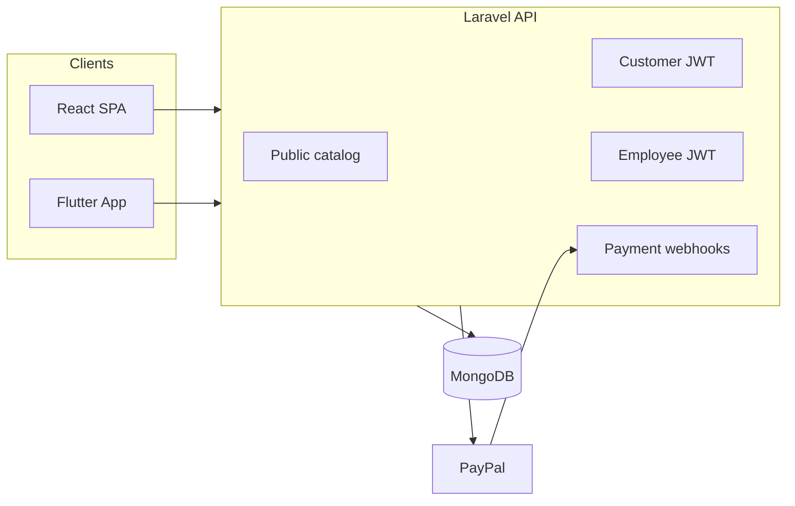

# Bookstore — Project Documentation

Full-stack online bookstore: catalog, cart, multi-warehouse orders, publisher and warehouse administration, walk-in point of sale (POS), and payments (cash on delivery, PayPal, Stripe webhook).

> **This file is the main project documentation.**
> The root, `web/` and `app/` READMEs are setup shortcuts; authentication details live in [AUTHENTICATION.md](./AUTHENTICATION.md).

---

## 1. Overview

| Area | Path | Stack / role |
|------|------|----------------|
| **REST API** | `api/` | Laravel 11 (PHP 8.2+), MongoDB via `mongodb/laravel-mongodb` 4, JWT via `tymon/jwt-auth` 2 — public catalog, customer cart/orders, admin, employee and POS APIs |
| **Web SPA** | `web/` | React 19, Vite 7, TypeScript, Tailwind CSS 4, TanStack Query 5, React Router 7, i18next (AR/EN) — storefront + admin + POS |
| **Mobile** | `app/` | Flutter (Dart 3.10+), Provider, `http`, `shared_preferences` — storefront, cart/checkout/orders, staff screens (admin, POS, warehouse quotes) |

**API base (dev):** `http://localhost:8000/api/v1`
**HTML API notes:** `http://localhost:8000/docs.html` while `php artisan serve` is running.



---

## 2. Product features

### Storefront (customers)

- Browse **books**, **categories**, **authors**, **warehouses** and **publishers** (public APIs, no login).
- Book cards and book detail link to the **publisher** (`/publishers/:id`) and **warehouse** (`/warehouses/:id`) book lists (web + Flutter).
- Books are **new** or **used** (`condition`); used books can carry any stock quantity and are marked sold when their stock runs out.
- Register / login, profile, logout.
- **Cart** and **checkout**: shipping address; payment methods = global settings **intersected** with the allowed methods of every publisher in the cart.
- Checkout **reserves stock immediately** (atomic, no overselling) and creates one order per warehouse in `pending_warehouse_review` with payment pending. Cancelling an order returns its stock exactly once.
- **Orders**: list/detail, quote confirmation, PayPal payment after the warehouse quote.

### Order lifecycle

1. Customer checks out → `pending_warehouse_review` (stock reserved).
2. Warehouse staff quote (shipping fee, method, payment method) → `awaiting_customer_confirmation`.
3. Customer confirms (or pays via PayPal) → `resubmitted_to_warehouse`.
4. Staff → `processing_fulfillment` → `shipped_collecting_payment`.
5. → `completed` (COD is marked paid on completion).

Any non-final order can be cancelled (stock is restored). Legacy MongoDB status strings are normalized on read. Orders created before checkout-time reservation still deduct stock when fulfillment starts.

### Administration & operations (employees)

Roles: `manager`, `publisher_manager`, `warehouse_manager`, `shipping`, `accounting`, `review`, `driver`, `direct_sales`.

| Capability | Notes |
|------------|--------|
| Books / authors / categories | CRUD; bulk delete; spreadsheet import; cover & author photo upload; **cover analysis** (barcode ISBN + OCR.space text recognition to prefill the book form) |
| **Publishers** | CRUD (managers); each publisher owns **multiple warehouses** |
| **Publisher settings** | Support contact, return policy, default discount, enabled payment methods, **payout accounts** (PayPal email / merchant ID, bank) and the **agreed platform commission %**. Readable/editable only by managers and that publisher's own manager; only managers can change the commission. **Site commission account** shows owed / accrued / transferred balances; publisher managers mark manual transfers to the site. Public/cart responses expose only `public_settings` (payment methods, support contact, return policy). |
| Warehouses | Belong to a publisher; `warehouse_manager` is scoped to assigned warehouse(s) |
| **Publisher manager** | Scoped to their publisher's warehouses, books, employees and orders |
| Customers / employees | Admin management; filter employees by role, publisher and warehouse; convert customer → employee; warehouse managers, shipping and direct-sales staff can have multiple warehouses |
| **Direct sales (POS)** | Walk-in invoices with optional customer name (no customer login). Staff pick books, create and print the invoice. Default catalog is the employee's own warehouse. Managers, publisher managers, warehouse managers and direct-sales staff (own invoices only) can review invoices. Reports show **today**, **this month**, **this year** and **all time** totals plus a day/month/year breakdown in the viewer's timezone. |
| Orders | List, assign, status, warehouse quote, bulk delete; shipping staff see fulfillment statuses; accounting sees all statuses |
| Settings | Global site options, payment methods, catalog items per page (default **27**) |
| Countries / reports | Country/city sync; books-without-cover report; browse books by warehouse |

### Payments

- Admin toggles COD / Stripe / PayPal globally.
- At checkout, methods = **global enabled ∩ all publishers in the cart**.
- Each publisher stores its own payout accounts. Customer PayPal payments are routed to that publisher when PayPal accepts the payee; otherwise the platform account collects and the split is still recorded.
- The platform commission is an agreed **percentage of book revenue** (not shipping), stored per publisher and snapshotted on each order and POS invoice (`platform_commission_*`, `publisher_payout_amount`).
- When a sale is finalized (order **completed**, or POS invoice created), that commission amount is **accrued** on the publishing house’s site-commission account (`commission_owed`). The publisher manager (or site manager) records a **manual transfer** to the site account via `POST /admin/publishers/{id}/commission-settlements`; balances and ledger are at `GET /admin/publishers/{id}/commission-account`.
- PayPal: after the quote, `POST /customers/orders/paypal/start` with `order_ids` → buyer approves on PayPal → `GET /paypal/complete` captures and verifies the amount; webhook `PAYMENT.CAPTURE.COMPLETED` when `PAYPAL_WEBHOOK_ID` is set. Clients only follow approval links on `https://*.paypal.com`.
- Env: `PAYPAL_*`, `STRIPE_*` — see `api/.env.example` and `api/config/paypal.php`.

---

## 3. Setup & run

### Requirements

- PHP 8.2+ with `mongodb`, `openssl`, `mbstring`, `tokenizer`, `xml`, `ctype`, `curl`; Composer
- MongoDB (standalone is fine; transactions are optional and need a replica set)
- Node 20.19+ or 22.12+ (required by Vite 7)
- Flutter SDK with Dart 3.10+
- Optional: ImageMagick (`convert`) for cover image processing, `OCR_SPACE_API_KEY` for cover text recognition

### API

```bash
cd api
cp .env.example .env
composer install
php artisan key:generate
php artisan jwt:secret
php artisan migrate
php artisan db:seed          # optional demo data
php artisan storage:link     # serve uploaded covers
php artisan serve            # or --host=0.0.0.0 for phones on the LAN
```

Set `MONGODB_URI` / `MONGODB_DATABASE` in `.env`.

**Seed accounts (after `db:seed`):**

| Email | Password | Role |
|-------|----------|------|
| `admin@bookstore.test` | `password` | manager |
| `manager@bookstore.test` | `password` | manager |
| `shipping@bookstore.test` | `password` | shipping |
| `warehouse-manager@bookstore.test` | `password` | warehouse_manager |
| `direct-sales@bookstore.test` | `password` | direct_sales |

`db:seed` also creates warehouses, publishers, Arabic locations, a demo catalog and demo POS invoices (`PosInvoiceSeeder`, also runnable alone with `--class=PosInvoiceSeeder`).

### Web

```bash
cd web
npm install
npm run dev                  # http://localhost:5173 — /api proxied to 127.0.0.1:8000
npm run build
```

Optional `web/.env`: `VITE_API_URL=https://api.example.com/api/v1` (omit in dev to use the Vite proxy).

### Flutter

The API URL is set at build time with `--dart-define`:

```bash
cd app
flutter pub get
flutter run                                          # Android emulator → 10.0.2.2:8000, iOS simulator/desktop → localhost:8000
flutter run --dart-define=API_HOST=192.168.x.x       # physical device on the same Wi‑Fi
flutter build apk --dart-define=API_BASE_URL=https://api.example.com/api/v1
```

Other defines: `API_SCHEME` (default `http`), `API_PORT` (default `8000`). Android allows cleartext HTTP **only in debug builds**; release builds need HTTPS.

Android build: AGP **9.1.0**, Kotlin **2.4.0**, Gradle wrapper **9.3.1** (`app/android/`).

### CORS

```env
CORS_ALLOWED_ORIGINS=http://localhost:5173,https://app.example.com
```

---

## 4. API overview

### Response shape

```json
{
  "success": true,
  "message": "",
  "data": {}
}
```

Send JWT as `Authorization: Bearer <token>`. Validation errors return 422 with `data.errors`; unexpected server errors return a generic message unless `APP_DEBUG=true`.

### Public (no auth)

| Method | Path | Notes |
|--------|------|--------|
| GET | `/books` | Filters: `search`, `category_id`, `author_id`, `warehouse_id`, `publisher_id`, `min_price`, `max_price`, `condition`, `in_stock` (default true), `per_page` (default 32, max 100). Only visible, unsold books with a cover. |
| GET | `/books/{id}` | Book detail + relations |
| GET | `/categories`, `/categories/{id}` | Dewey categories (show does **not** embed all books) |
| GET | `/authors`, `/authors/{id}` | Authors (show does **not** embed all books) |
| GET | `/warehouses`, `/warehouses/{id}` | Warehouses |
| GET | `/publishers`, `/publishers/{id}` | Publishers (`public_settings` only) |
| GET | `/settings` | Public settings (discount, payment method flags, …) |

### Customer

| Method | Path |
|--------|------|
| POST | `/customers/register`, `/customers/login` |
| GET / POST | `/customers/me`, `/customers/refresh`, `/customers/logout` |
| PUT | `/customers/profile` |
| GET / POST / PATCH / DELETE | `/customers/cart`, `/customers/cart/items`, `/customers/cart/items/{bookId}` |
| POST | `/customers/orders/checkout`, `/customers/orders/paypal/start` |
| GET / POST / PATCH | `/customers/orders`, `/customers/orders/{id}`, `/customers/orders/{id}/confirm-quote`, `/customers/orders/{id}/status` (cancel) |

### Employee & admin

| Method | Path |
|--------|------|
| POST | `/employees/login`, `/employees/refresh`, `/employees/logout`; GET `/employees/me` |
| GET / PATCH / POST | `/employees/orders`, `/employees/orders/{id}`, `/employees/orders/{id}/status`, `/employees/orders/{id}/warehouse-quote` |
| CRUD | `/admin/books` (+ `bulk-delete`, `import`), `/admin/authors`, `/admin/categories`, `/admin/publishers` (+ `{id}/settings`), `/admin/warehouses`, `/admin/employees`, `/admin/customers` (+ `convert-to-employee`) |
| * | `/admin/orders` (list, show, status, assign, warehouse-quote, delete, bulk-delete) |
| * | `/admin/settings`, `/admin/countries` (+ sync), `/admin/upload-cover`, `/admin/upload-author-photo`, `/admin/analyze-cover` |
| GET / POST | `/admin/pos/books`, `/admin/pos/invoices`, `/admin/pos/invoices/{id}`, `/admin/pos/reports` |

The admin group applies `role:*` checks plus `restrict.warehouse_manager`, `restrict.publisher_manager` and `restrict.direct_sales` scoping middleware.

### Payments / webhooks

- `POST /webhooks/stripe` (signature verified with `STRIPE_WEBHOOK_SECRET`), `POST /webhooks/paypal` (verified through PayPal when `PAYPAL_WEBHOOK_ID` is set; rejected otherwise)
- `GET /paypal/complete`

### Rate limits

| Limiter | Default | Applies to |
|---------|---------|-----------|
| `api` | 60/min per IP (guests), 300/min per account (signed in) | Whole `/api/v1` group |
| `login` | 5/min per email+IP, 20/min per IP | Customer and employee login |
| `heavy` | 6/min per account | Cover analysis, book import, country/city sync |

Configured in `api/config/rate_limits.php` (`RATE_LIMIT_*` env vars). Registration, refresh, checkout and PayPal start have their own route limits.

### Postman / manual testing

1. `POST {{baseUrl}}/customers/login` → copy `data.token`.
2. Protected calls: Authorization → **Bearer Token**.
3. Employees: `POST {{baseUrl}}/employees/login`, then Bearer for `/admin/...`.

---

## 5. Domain model (core)

- **Publisher** → has many **Warehouses**; `settings` holds payout data (hidden from JSON), `public_settings` is the safe subset.
- **Book** → authors (`author_ids`), category, publisher(s) (`publisher_id`, `publisher_ids`), warehouse; `condition` (`new`/`used`), `is_visible`, `is_sold`, `has_cover` (maintained on save).
- **Order** → one warehouse, `items`, `status`, `stock_reserved`, payment fields and commission snapshot.
- **POS invoice** → an order with `is_direct_sale`, optional `customer_name`, and the selling `employee_id`.
- **Settings** → global site settings collection.

---

## 6. Performance & caching (large catalogs)

Designed for **100k+** books/authors:

| Technique | Detail |
|-----------|--------|
| **Indexes** | Catalog compound index (`has_cover` + stock + newest); order indexes by customer, status, warehouse, employee, direct sale and payment status; cart, employee and publisher lookups |
| **Cached pagination totals** | Book/author totals cached and versioned with the catalog cache |
| **Catalog page cache** | `CachedCatalogService` when `CACHE_CATALOG_ENABLED=true` |
| **Cache invalidation** | A catalog version (`App\Support\CatalogCache`) is bumped on book writes and automatically on category/author/publisher/warehouse save or delete |
| **Lean endpoints** | Author/category/warehouse show do not load all related books; lists use paginated `/books?…` filters |
| **Batch loading** | Cart, checkout, PayPal and bulk actions load books/orders in one query |
| **POS reports** | Aggregated in MongoDB (grouped by local day) instead of loading every invoice |
| **Web** | Lazy-loaded route chunks, lazy images, TanStack Query `staleTime` 60 s |
| **Flutter** | Shared HTTP client with timeouts, large JSON decoded off the UI thread, covers decoded at display size |

```env
CACHE_STORE=file                 # prefer redis in production
CACHE_CATALOG_ENABLED=true
CACHE_CATEGORIES_TTL=3600
CACHE_AUTHORS_TTL=3600
CACHE_BOOKS_TTL=900
CACHE_BOOKS_TOTAL_TTL=3600
CATALOG_MAX_OFFSET_PAGE=200
```

`php artisan catalog:clear-cache` bumps the catalog version manually.

---

## 7. Artisan commands, import & load testing

| Command | Purpose |
|---------|---------|
| `books:import-ods {file}` | Import books from ODS/XLSX/XLS/CSV. Flags: `--warehouse=ID`, `--skip-cover`, `--dry-run`, `--clear`, `--title-col=`, `--author-col=`, `--category-col=`, … Requires at least one warehouse. |
| `db:seed-large` | Bulk-seed books (with placeholder covers) and optional authors: `--books=`, `--target-books=`, `--authors=`, `--chunk=`, `--in-stock-ratio=` |
| `books:distribute-warehouses` | Spread books across warehouses |
| `authors:clean-titles` | Normalize author names |
| `catalog:clear-cache` | Invalidate the catalog cache |
| `countries:sync-from-network`, `countries:sync-cities-from-dataset` | Refresh countries and cities |

```bash
cd api && php artisan db:seed-large --books=100000 --authors=100000 --chunk=5000
cd api && php artisan db:seed-large --target-books=1000000 --authors=0 --chunk=5000
```

---

## 8. Testing & CI

| Suite | Location | Notes |
|-------|----------|-------|
| Unit | `api/tests/Unit/` | No database |
| Feature | `api/tests/Feature/` | Real MongoDB in the **`book_store_test`** database (set in `phpunit.xml`); refuses to run against a database not ending in `_test`; skipped when MongoDB is unreachable. Covers atomic stock (including parallel processes), checkout reservation/cancel, publisher settings exposure and authorization, publisher-manager order scope, POS report aggregation, rate limiting and cache invalidation. |

```bash
cd api
php artisan test                    # both suites
php artisan test --testsuite=Unit
```

Web: `npx tsc -b`, `npx eslint src`, `npm run build`.
Flutter: `flutter analyze`.

CI (`.github/workflows/ci.yml`, on push/PR to `main`/`master`): API unit tests (PHP 8.3), web build (Node 22), Flutter analyze.

---

## 9. Localization

- **Web:** `web/src/i18n/en.json`, `ar.json` (i18next); RTL by default.
- **Mobile:** `app/lib/l10n`.
- **API:** messages localized from `Accept-Language` (`api/lang/`); bilingual category fields (`subject_title_en` / `subject_title_ar`).

---

## 10. Security (operators)

- Never commit `.env`, JWT secrets, PayPal/Stripe/OCR keys or keystores.
- Production: `APP_DEBUG=false`, strong `APP_KEY` + `JWT_SECRET`, HTTPS, restricted `CORS_ALLOWED_ORIGINS`, `PAYPAL_WEBHOOK_ID` and `STRIPE_WEBHOOK_SECRET` set.
- Build the Flutter app with an HTTPS `API_BASE_URL`; release builds block cleartext HTTP.
- Tokens are stored in `localStorage` (web) and `shared_preferences` (Flutter); see [AUTHENTICATION.md](./AUTHENTICATION.md).

---

## 11. Backend patterns

- Controllers → Form Requests → Services → Repositories / domain interfaces (`app/Domain`, `app/Infrastructure`).
- Middleware: `role:*`, `restrict.warehouse_manager`, `restrict.publisher_manager`, `restrict.direct_sales`, `throttle:api|login|heavy`.
- Business-rule errors are thrown as `InvalidArgumentException` and returned as 422; other exceptions are masked.
- Stock changes are single conditional updates, so they are safe without transactions; optional MongoDB transactions when a replica set is available (`MONGODB_TRANSACTIONS`).

---

## العربية — وصف مختصر

### الفكرة

منظومة تجارة إلكترونية لبيع الكتب: كتالوج، سلة، طلبات متعددة المستودعات، إدارة للناشرين والمستودعات، نقطة بيع مباشرة (POS)، وطرق دفع (عند الاستلام / PayPal / Stripe). موقع الويب (React) وتطبيق الجوال (Flutter) يشتركان في **API موحّد (Laravel)** و**MongoDB**، مع JWT منفصل **للعميل** و**للموظف**.

### من يستخدم النظام؟

- **العميل:** تصفح (كتب جديدة ومستعملة، تصنيفات، مؤلفون، مستودعات، ناشرون)، سلة، دفع، متابعة الطلبات.
- **الموظف:** أدوار متعددة (مدير، مدير ناشر، مشرف مستودع، شحن، محاسبة، مراجعة، سائق، بيع مباشر). إدارة الكتب والمؤلفين والتصنيفات والناشرين والمستودعات والعملاء والموظفين والطلبات والإعدادات وفواتير نقطة البيع.

### سلوك الطلب

- كل كتاب مرتبط بمستودع وناشر. السلة من عدة مستودعات تُقسَّم إلى عدة طلبات.
- يُحجز المخزون فور إتمام الشراء بشكل ذرّي (لا بيع لنسخ غير متوفرة)، ويُعاد مرة واحدة فقط عند الإلغاء.
- المسار: مراجعة المستودع → عرض سعر → تأكيد العميل → تجهيز → شحن → إكمال.
- طرق الدفع = تقاطع الإعدادات العامة مع إعدادات **كل ناشر** في السلة.
- لكل دار نشر حسابات تحصيل خاصة (PayPal / بنك) لا تظهر إلا للمدير ولمدير الناشر نفسه. عمولة إدارة المشروع نسبة متفق عليها من إيراد الكتب وتُحفظ على كل طلب وفاتورة.

### الأمان والأداء

- حدود لمعدل الطلبات (للزوار، للمستخدمين، لتسجيل الدخول، وللعمليات الثقيلة).
- فهارس للكتالوج والطلبات، تخزين مؤقت للصفحات والمجاميع يُحدَّث تلقائياً عند التعديل، وتقارير نقطة البيع تُحسب داخل قاعدة البيانات.

### التشغيل

راجع قسم **Setup & run** أعلاه لأوامر `composer` / `npm` / `flutter`، وحسابات البذرة، وإعداد عنوان الـ API للتطبيق عبر `--dart-define`.
